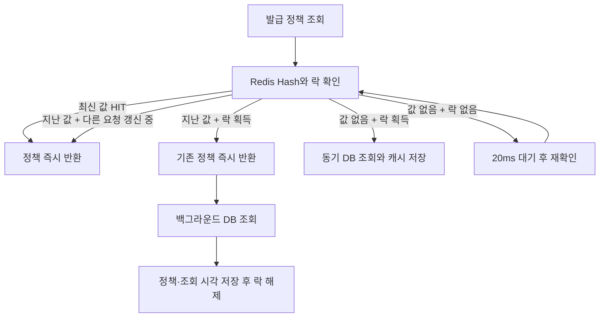

# Coupon Issue System · Stale-While-Revalidate

**캐시 갱신을 기다리지 않고 기존 쿠폰 정책을 먼저 반환하는 단계입니다.** Single-flight의 락은 유지하되, 캐시가 남아 있는 동안 DB 재조회는 백그라운드에서 수행합니다.

> 현재 단계: `feature/swr` · 코드 기준: [5ae23ee](https://github.com/Ryudirc/couponIssueSystem/commit/5ae23ee). 강의 기반 학습 프로젝트의 브랜치별 구현 기록입니다.

## 브랜치별 발전 과정

| 단계 | 브랜치 | 집중한 문제 | 추가한 방법 |
|---|---|---|---|
| 1 | [main](https://github.com/Ryudirc/couponIssueSystem/tree/main) | 발급 요청마다 DB 저장을 기다리는 부담 | Redis Lua 선차감 + Kafka 비동기 저장 |
| 2 | [single-flight](https://github.com/Ryudirc/couponIssueSystem/tree/feature/cache_singleFlight) | 캐시가 비면 같은 쿠폰을 동시에 DB에서 조회 | 대표 요청 하나가 캐시를 채우고 나머지는 대기 |
| 3 | [SWR](https://github.com/Ryudirc/couponIssueSystem/tree/feature/swr) | 캐시 갱신 중 응답이 기다리는 문제 | 기존 값을 먼저 반환하고 뒤에서 갱신 |
| 4 | [Caffeine](https://github.com/Ryudirc/couponIssueSystem/tree/feature/caffeine_cache) | 매진 후에도 반복되는 Redis 요청 | 프로세스 내부에서 매진 여부를 짧게 캐시 |

각 브랜치는 앞 단계의 구현을 이어받습니다. **발급 재고**, **쿠폰 발급 정책 캐시**, **매진 여부 캐시**는 서로 다른 데이터입니다. 정책 캐시가 오래됐더라도 실제 재고 확인·차감은 Redis Lua에서 수행합니다.

## 문제와 선택

Single-flight는 조회를 모으지만 다른 요청은 갱신이 끝나기를 기다립니다. **SWR(Stale-While-Revalidate)**은 “조금 지난 값을 먼저 사용하면서 새 값을 확인한다”는 전략입니다. 여기서 오래된 값은 **재고가 아니라 쿠폰 정책**입니다.



1. Redis Hash에 `value`와 `fetchedAtMs`를 함께 보관합니다.
2. 조회 시각부터 `fresh-ms` 안이면 최신으로 보고 반환합니다.
3. 최신 구간은 지났지만 TTL 안이면 기존 정책을 반환합니다. 락을 얻은 요청만 4개 스레드의 실행기에 갱신을 맡깁니다.
4. TTL이 지나 값 자체가 없으면 기다리지 않을 값도 없습니다. 이때는 이전 단계처럼 **동기 LOAD 또는 WAIT**로 처리합니다.
5. 정책 반환 이후 시작 시각 확인·재고 Lua·Kafka·Worker 저장 흐름은 유지됩니다.

### 핵심 코드

| 책임 | 코드 |
|---|---|
| 즉시 반환과 비동기 갱신 분리 | [CouponCacheRepository](src/main/kotlin/com/travio/coupon/infrastructure/cache/CouponCacheRepository.kt)의 `getOrLoad·fillCache` |
| 최신·지난 값·미존재 판별 | [cache-single-flight-swr.lua](src/main/resources/lua/cache-single-flight-swr.lua) |
| 정책 값과 최신 구간 | [CouponIssuePolicy](src/main/kotlin/com/travio/coupon/application/CouponIssuePolicy.kt), [CacheProperties](src/main/kotlin/com/travio/coupon/infrastructure/cache/CacheProperties.kt) |
| 발급 경로 연결 | [CouponService](src/main/kotlin/com/travio/coupon/application/CouponService.kt) |

### 설정과 비용

| 항목 | 앱 단독 기본값 | Compose 기본값 |
|---|---:|---:|
| 정책 TTL | 10,000ms | 1,000ms |
| 최신으로 보는 구간 `fresh-ms` | 500ms | 500ms |
| 인위적 DB 지연 | 0ms | 100ms |

`fresh-ms < ttl-ms`여야 기존 값을 반환하며 갱신할 구간이 생깁니다. 이전 정책을 허용하는 대신 정책 변경 반영은 지연될 수 있습니다. 재고·사용자 중복 여부는 이 캐시로 승인하지 않고 별도 Redis Lua로 확인합니다.

## API

사용자 식별은 학습용 `X-User-Id` 헤더를 사용합니다. JWT 인증을 구현한 API가 아닙니다.

| Method | 경로 | 요청 | 응답 |
|---|---|---|---|
| POST | `/api/coupons` | 쿠폰 이름·수량·유효 일수·선택 시작 시각 | 201, 생성된 쿠폰 정보 |
| POST | `/api/coupons/{couponId}/issue` | `X-User-Id` | 200, 발급 요청 정보 |
| GET | `/api/users/me/issuances` | `X-User-Id` | 200, DB에 저장된 발급 내역 배열 |
| POST | `/api/issuances/{issuanceId}/use` | `X-User-Id` | 200, 사용 처리한 발급 내역 |

발급 API의 200은 **DB 저장 완료를 뜻하지 않습니다.** 응답의 `id`는 아직 `null`이며, Worker 저장 후 목록 조회에서 실제 발급 ID를 얻습니다. 시작 전·매진·중복 발급은 409, 없는 쿠폰·발급 내역은 404입니다.

```sh
# 시작 시각을 생략하면 즉시 발급 가능
curl -X POST http://localhost:8080/api/coupons \
  -H 'Content-Type: application/json' \
  -d '{"name":"선착순 쿠폰","totalQuantity":100,"validityDays":7}'

# 생성 응답의 id를 couponId로 사용
curl -X POST http://localhost:8080/api/coupons/1/issue -H 'X-User-Id: 101'
curl http://localhost:8080/api/users/me/issuances -H 'X-User-Id: 101'
```

## 실행

**필수:** JDK 25, Docker Compose. 부하 실험은 추가로 Bash(Git Bash/WSL), k6, curl, jq가 필요합니다.

- Kotlin 2.3.21 / Spring Boot 4.1.1 / Spring Data JPA
- MySQL 8.4 / Redis 8.0 / Kafka 3.8.0(KRaft)
- Gradle Wrapper / Jib 3.5.4

현재 브랜치 루트에서 실행합니다. 기본 포트 `8080·3306·6379·9094`가 다른 프로젝트와 충돌하지 않아야 합니다.

```sh
docker compose up -d mysql redis kafka
./gradlew bootRun
```

Windows PowerShell에서는 `./gradlew` 대신 `.\gradlew.bat`을 사용합니다. 컨테이너로 앱까지 실행하려면 다음 명령을 사용합니다.

```sh
./gradlew jibDockerBuild
docker compose up -d
```

Compose는 이미지를 직접 빌드하지 않습니다. **브랜치를 바꿨다면 Jib로 다시 빌드**해야 해당 브랜치 코드가 실행됩니다. Jib 설정은 Docker Desktop의 `desktop` credential helper를 사용합니다. 접속 정보는 [application.yaml](src/main/resources/application.yaml), 컨테이너 구성은 [docker-compose.yml](docker-compose.yml)을 참고합니다.

**브랜치 전환 주의:** Single-flight는 Redis String, SWR은 같은 정책 키에 Hash를 사용합니다. 기존 String 키가 남아 있으면 `WRONGTYPE`이 발생할 수 있으므로 전용 테스트 환경의 기존 정책 키를 정리한 뒤 실행합니다.

## 검증 방법과 기록 범위

| 도구 | 확인할 내용 |
|---|---|
| [초과 발급 실험](scripts/load/run.sh) | 발급 행 수가 총량 이하인지, DB 카운터와 실제 행 수가 일치하는지 |
| [응답 부하 실험](scripts/response/run.sh) | 발급 API 지연과 Worker 저장 이후의 DB 상태 |
| [Spring 테스트](src/test/kotlin/com/travio/coupon/CouponApplicationTests.kt) | 애플리케이션 컨텍스트 기동 (`contextLoads` 1개) |

```sh
./gradlew test
bash scripts/response/run.sh --once
```

**주의:** 실험 스크립트는 `coupon·issuance` 테이블을 TRUNCATE하고 Redis DB를 FLUSHDB합니다. 전용 로컬 환경에서만 실행하며, 이전 Kafka 메시지의 소비도 끝난 상태에서 측정해야 합니다. DB 행 수가 잠시 변하지 않는다는 사실만으로 전체 메시지 처리가 끝났다고 단정할 수는 없습니다.

이 README 갱신에서는 코드·설정·스크립트·Git 이력을 대조했으며, 앱 기동·자동화 테스트·k6 부하 실험은 실행하지 않았습니다. 스크립트의 부하량과 p99 기준은 **실험 조건·목표이지 달성 결과가 아닙니다.** 성능 개선율과 장애 복구 보장을 제시하려면 실행 환경과 결과를 별도로 기록해야 합니다.

### 캐시 실험

```sh
bash scripts/cache/run.sh --once policy
bash scripts/cache/run.sh --once sellout
curl http://localhost:8080/metrics/cache
```

| API / 지표 | 의미 |
|---|---|
| `GET /metrics/cache` | 현재 프로세스의 누적 카운터 조회 |
| `POST /metrics/cache/reset` | 측정 카운터만 초기화; 캐시 삭제 아님 |
| `couponDbReads` | 정책 loader 실행 횟수; DB 조회 실패 시도도 포함 |
| `couponCacheHits` | 캐시 정책 반환 횟수 |
| `soldOutRedisExists` | 매진 플래그 Redis 조회 횟수 |
| `soldOutFastPathHits` | 로컬 캐시에서 매진으로 거절한 횟수 |

카운터는 `AtomicLong` 기반으로 서버 재시작 시 초기화되며, 다중 인스턴스 합산 지표가 아닙니다. 매진 지표는 Caffeine 단계에서 실제 증가합니다.

정책 실험은 500 요청/초·30초이며 p99 200ms 미만이 목표입니다. SWR에서는 DB 조회 횟수뿐 아니라 갱신 구간의 응답 지연도 비교합니다. 러너는 k6 실패 코드를 무시하므로 종료 코드만으로 목표 달성을 판단하지 않습니다.

## 현재 한계와 후속 과제

- Redis 선차감과 Kafka 전송·MySQL 저장은 하나의 트랜잭션이 아닙니다. Producer는 `send()` 완료를 기다리지 않고 Outbox도 없어, 전송 실패 시 재고와 DB 내역이 어긋날 수 있습니다.
- DB의 `(user_id, coupon_id)` Unique 제약은 중복 저장을 막지만, Writer가 모든 `DataIntegrityViolationException`을 중복으로 간주하므로 다른 무결성 오류를 구분해야 합니다.
- 현재 발급자 Redis Set 키는 쿠폰 ID가 아닌 사용자 ID를 사용합니다. 따라서 서로 다른 쿠폰을 같은 사용자가 발급받는 경우에도 중복으로 판단할 수 있어 수정·검증이 필요합니다.
- `X-User-Id`는 인증되지 않은 입력입니다. 쿠폰 사용 시 소유권 검사와 동시 사용 제어도 보강해야 합니다. 현재 코드를 운영용 보안·정합성 완성본으로 보지 않습니다.

- 백그라운드 갱신 실패는 경고 로그만 남깁니다. TTL 만료 후에는 동기 조회로 돌아가며, 실행기 대기열 제한·락 만료 이후의 늦은 캐시 덮어쓰기 보호는 구현되어 있지 않습니다.
- Redis Hash 저장과 TTL 설정은 별도 명령입니다. 중간 장애에 따른 TTL 미설정 가능성도 후속 검증 대상입니다.

## 다음 단계

매진 후의 요청은 정책 조회조차 필요하지 않을 수 있습니다. 다음 [Caffeine 브랜치](https://github.com/Ryudirc/couponIssueSystem/tree/feature/caffeine_cache)는 매진 여부를 로컬에서 짧게 기억해 요청 초입에서 거절합니다.
