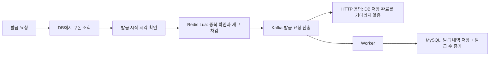

# Coupon Issue System

**Redis Lua와 Kafka로 선착순 쿠폰 발급을 처리하는 Kotlin/Spring 학습 프로젝트입니다.** 이 브랜치는 캐시 최적화 전 기준 구현이며, 이후 브랜치에서 DB 조회 집중과 매진 이후의 반복 요청을 줄이는 과정을 이어갑니다.

> 현재 단계: `main` · 코드 기준: [d2f7569](https://github.com/Ryudirc/couponIssueSystem/commit/d2f7569). 강의 기반 학습 코드이며, 여기서는 현재 저장소에서 확인되는 구현과 한계만 설명합니다.

## 브랜치별 발전 과정

| 단계 | 브랜치 | 집중한 문제 | 추가한 방법 |
|---|---|---|---|
| 1 | [main](https://github.com/Ryudirc/couponIssueSystem/tree/main) | 발급 요청마다 DB 저장을 기다리는 부담 | Redis Lua 선차감 + Kafka 비동기 저장 |
| 2 | [single-flight](https://github.com/Ryudirc/couponIssueSystem/tree/feature/cache_singleFlight) | 캐시가 비면 같은 쿠폰을 동시에 DB에서 조회 | 대표 요청 하나가 캐시를 채우고 나머지는 대기 |
| 3 | [SWR](https://github.com/Ryudirc/couponIssueSystem/tree/feature/swr) | 캐시 갱신 중 응답이 기다리는 문제 | 기존 값을 먼저 반환하고 뒤에서 갱신 |
| 4 | [Caffeine](https://github.com/Ryudirc/couponIssueSystem/tree/feature/caffeine_cache) | 매진 후에도 반복되는 Redis 요청 | 프로세스 내부에서 매진 여부를 짧게 캐시 |

각 브랜치는 앞 단계의 구현을 이어받습니다. **발급 재고**, **쿠폰 발급 정책 캐시**, **매진 여부 캐시**는 서로 다른 데이터입니다. 정책 캐시가 오래됐더라도 실제 재고 확인·차감은 Redis Lua에서 수행합니다.

## 핵심 처리 흐름



1. 쿠폰 생성 시 MySQL에 쿠폰 한 건을 저장하고 Redis에 초기 재고를 설정합니다.
2. 발급 요청은 쿠폰과 시작 시각을 확인한 뒤, Lua 한 번으로 중복 확인·재고 차감·발급자 기록을 수행합니다.
3. 통과한 요청을 `issuance.requested`에 JSON으로 전송합니다. Key는 `userId` 문자열입니다.
4. Worker가 발급 내역 INSERT와 쿠폰 발급 수 증가를 **하나의 DB 트랜잭션**으로 처리합니다.
5. Consumer 오류는 1초 간격으로 최대 3회 재시도하도록 설정되어 있으며, 복구 경로는 `issuance.requested.DLT`입니다. 두 토픽은 각각 3개 Partition·복제 수 1입니다.

Redis Lua의 원자성은 **Redis 내부 작업**에만 적용됩니다. Redis→Kafka→MySQL 전체를 한 번에 성공시키는 보장은 아닙니다.

### 핵심 코드

| 책임 | 코드 |
|---|---|
| 생성·발급 요청 조합 | [CouponService](src/main/kotlin/com/travio/coupon/application/CouponService.kt) |
| 재고·중복 판단 | [CouponIssuer](src/main/kotlin/com/travio/coupon/application/CouponIssuer.kt), [issue.lua](src/main/resources/lua/issue.lua) |
| Kafka 요청 전송 | [IssuanceRequestProducer](src/main/kotlin/com/travio/coupon/infrastructure/messaging/IssuanceRequestProducer.kt) |
| 중복 예외와 DB 트랜잭션 분리 | [IssuanceWriter](src/main/kotlin/com/travio/coupon/infrastructure/messaging/IssuanceWriter.kt), [IssuanceTransactionalWriter](src/main/kotlin/com/travio/coupon/infrastructure/messaging/IssuanceTransactionalWriter.kt) |
| 중복 저장 최종 방어선 | [Issuance](src/main/kotlin/com/travio/coupon/domain/Issuance.kt)의 Unique 제약 |

## API

사용자 식별은 학습용 `X-User-Id` 헤더를 사용합니다. JWT 인증을 구현한 API가 아닙니다.

| Method | 경로 | 요청 | 응답 |
|---|---|---|---|
| POST | `/api/coupons` | 쿠폰 이름·수량·유효 일수·선택 시작 시각 | 201, 생성된 쿠폰 정보 |
| POST | `/api/coupons/{couponId}/issue` | `X-User-Id` | 200, 발급 요청 정보 |
| GET | `/api/users/me/issuances` | `X-User-Id` | 200, DB에 저장된 발급 내역 배열 |
| POST | `/api/issuances/{issuanceId}/use` | `X-User-Id` | 200, 사용 처리한 발급 내역 |

발급 API의 200은 **DB 저장 완료를 뜻하지 않습니다.** 응답의 `id`는 아직 `null`이며, Worker 저장 후 목록 조회에서 실제 발급 ID를 얻습니다. 시작 전·매진·중복 발급은 409, 없는 쿠폰·발급 내역은 404입니다.

```sh
# 시작 시각을 생략하면 즉시 발급 가능
curl -X POST http://localhost:8080/api/coupons \
  -H 'Content-Type: application/json' \
  -d '{"name":"선착순 쿠폰","totalQuantity":100,"validityDays":7}'

# 생성 응답의 id를 couponId로 사용
curl -X POST http://localhost:8080/api/coupons/1/issue -H 'X-User-Id: 101'
curl http://localhost:8080/api/users/me/issuances -H 'X-User-Id: 101'
```

## 실행

**필수:** JDK 25, Docker Compose. 부하 실험은 추가로 Bash(Git Bash/WSL), k6, curl, jq가 필요합니다.

- Kotlin 2.3.21 / Spring Boot 4.1.1 / Spring Data JPA
- MySQL 8.4 / Redis 8.0 / Kafka 3.8.0(KRaft)
- Gradle Wrapper / Jib 3.5.4

현재 브랜치 루트에서 실행합니다. 기본 포트 `8080·3306·6379·9094`가 다른 프로젝트와 충돌하지 않아야 합니다.

```sh
docker compose up -d mysql redis kafka
./gradlew bootRun
```

Windows PowerShell에서는 `./gradlew` 대신 `.\gradlew.bat`을 사용합니다. 컨테이너로 앱까지 실행하려면 다음 명령을 사용합니다.

```sh
./gradlew jibDockerBuild
docker compose up -d
```

Compose는 이미지를 직접 빌드하지 않습니다. **브랜치를 바꿨다면 Jib로 다시 빌드**해야 해당 브랜치 코드가 실행됩니다. Jib 설정은 Docker Desktop의 `desktop` credential helper를 사용합니다. 접속 정보는 [application.yaml](src/main/resources/application.yaml), 컨테이너 구성은 [docker-compose.yml](docker-compose.yml)을 참고합니다.

## 검증 방법과 기록 범위

| 도구 | 확인할 내용 |
|---|---|
| [초과 발급 실험](scripts/load/run.sh) | 발급 행 수가 총량 이하인지, DB 카운터와 실제 행 수가 일치하는지 |
| [응답 부하 실험](scripts/response/run.sh) | 발급 API 지연과 Worker 저장 이후의 DB 상태 |
| [Spring 테스트](src/test/kotlin/com/travio/coupon/CouponApplicationTests.kt) | 애플리케이션 컨텍스트 기동 (`contextLoads` 1개) |

```sh
./gradlew test
bash scripts/response/run.sh --once
```

**주의:** 실험 스크립트는 `coupon·issuance` 테이블을 TRUNCATE하고 Redis DB를 FLUSHDB합니다. 전용 로컬 환경에서만 실행하며, 이전 Kafka 메시지의 소비도 끝난 상태에서 측정해야 합니다. DB 행 수가 잠시 변하지 않는다는 사실만으로 전체 메시지 처리가 끝났다고 단정할 수는 없습니다.

이 README 갱신에서는 코드·설정·스크립트·Git 이력을 대조했으며, 앱 기동·자동화 테스트·k6 부하 실험은 실행하지 않았습니다. 스크립트의 부하량과 p99 기준은 **실험 조건·목표이지 달성 결과가 아닙니다.** 성능 개선율과 장애 복구 보장을 제시하려면 실행 환경과 결과를 별도로 기록해야 합니다.

## 현재 한계와 후속 과제

- Redis 선차감과 Kafka 전송·MySQL 저장은 하나의 트랜잭션이 아닙니다. Producer는 `send()` 완료를 기다리지 않고 Outbox도 없어, 전송 실패 시 재고와 DB 내역이 어긋날 수 있습니다.
- DB의 `(user_id, coupon_id)` Unique 제약은 중복 저장을 막지만, Writer가 모든 `DataIntegrityViolationException`을 중복으로 간주하므로 다른 무결성 오류를 구분해야 합니다.
- 현재 발급자 Redis Set 키는 쿠폰 ID가 아닌 사용자 ID를 사용합니다. 따라서 서로 다른 쿠폰을 같은 사용자가 발급받는 경우에도 중복으로 판단할 수 있어 수정·검증이 필요합니다.
- `X-User-Id`는 인증되지 않은 입력입니다. 쿠폰 사용 시 소유권 검사와 동시 사용 제어도 보강해야 합니다. 현재 코드를 운영용 보안·정합성 완성본으로 보지 않습니다.

## 다음 단계

현재는 같은 쿠폰의 반복 요청도 매번 DB를 조회합니다. 다음 [single-flight 브랜치](https://github.com/Ryudirc/couponIssueSystem/tree/feature/cache_singleFlight)는 정책을 캐시하고, 캐시 만료 순간 DB 조회가 한꺼번에 몰리는 문제를 다룹니다.
