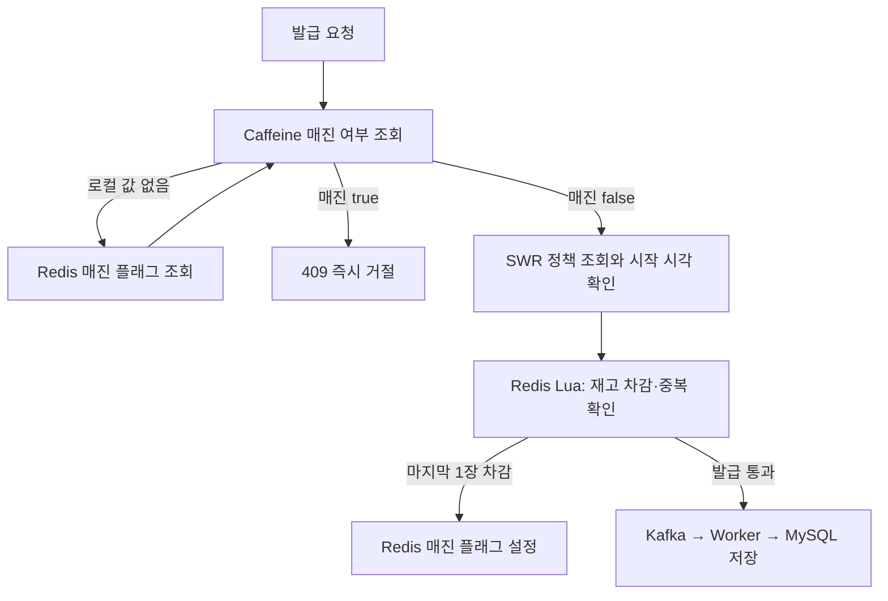

# Coupon Issue System · Caffeine Sold-Out Cache

**매진 후 반복되는 발급 요청을 로컬 캐시에서 빠르게 거절하는 단계입니다.** SWR 정책 캐시는 유지하고, 그 앞에 Caffeine 기반 매진 여부 확인을 추가했습니다.

> 현재 단계: `feature/caffeine_cache` · 코드 기준: [0d7972f](https://github.com/Ryudirc/couponIssueSystem/commit/0d7972f). 강의 기반 학습 프로젝트의 브랜치별 구현 기록입니다.

## 브랜치별 발전 과정

| 단계 | 브랜치 | 집중한 문제 | 추가한 방법 |
|---|---|---|---|
| 1 | [main](https://github.com/Ryudirc/couponIssueSystem/tree/main) | 발급 요청마다 DB 저장을 기다리는 부담 | Redis Lua 선차감 + Kafka 비동기 저장 |
| 2 | [single-flight](https://github.com/Ryudirc/couponIssueSystem/tree/feature/cache_singleFlight) | 캐시가 비면 같은 쿠폰을 동시에 DB에서 조회 | 대표 요청 하나가 캐시를 채우고 나머지는 대기 |
| 3 | [SWR](https://github.com/Ryudirc/couponIssueSystem/tree/feature/swr) | 캐시 갱신 중 응답이 기다리는 문제 | 기존 값을 먼저 반환하고 뒤에서 갱신 |
| 4 | [Caffeine](https://github.com/Ryudirc/couponIssueSystem/tree/feature/caffeine_cache) | 매진 후에도 반복되는 Redis 요청 | 프로세스 내부에서 매진 여부를 짧게 캐시 |

각 브랜치는 앞 단계의 구현을 이어받습니다. **발급 재고**, **쿠폰 발급 정책 캐시**, **매진 여부 캐시**는 서로 다른 데이터입니다. 정책 캐시가 오래됐더라도 실제 재고 확인·차감은 Redis Lua에서 수행합니다.

## 문제와 선택

SWR이 정책 조회를 줄여도 매진 후 요청은 Redis 재고 Lua까지 도달합니다. 매진된 쿠폰은 대부분 같은 결론으로 거절되므로, **매진 여부만 JVM 메모리에 짧게 기억**하도록 했습니다. Caffeine은 쿠폰 정책 전체를 캐시하는 용도가 아닙니다.



1. `SoldOutState`의 LoadingCache가 쿠폰 ID별 매진 여부를 조회합니다.
2. 로컬 값이 없으면 Redis 플래그 존재 여부를 읽어 `true/false`를 저장합니다. 둘 다 캐시하며, 기본 TTL은 1초입니다.
3. `true`면 정책·재고 조회 전 거절합니다. `false`면 기존 발급 경로를 진행합니다.
4. Redis Lua가 마지막 재고를 차감할 때 매진 플래그를 함께 설정합니다. 플래그 TTL은 기본 86,400초입니다.
5. 이미 로컬에 `false`가 있다면 TTL 만료 전까지 매진을 모르고 Lua로 진입할 수 있습니다. **최종 재고 판단은 여전히 Lua**이므로 로컬 캐시는 승인 수단이 아닙니다.

### 캐시의 역할 구분

| 데이터 | 위치 | 역할 |
|---|---|---|
| 발급 정책·조회 시각 | Redis Hash / SWR | 반복 DB 조회와 갱신 대기 감소 |
| 재고·발급자 집합 | Redis / Lua | 발급 허용 여부 판단 |
| 매진 플래그 | Redis | 서버들이 조회할 공유 매진 정보 |
| 매진 여부 Boolean | Caffeine / JVM | Redis 조회 전 조기 거절; 최대 1,000개 쿠폰 |
| 확정 발급 내역 | MySQL | Kafka Worker가 저장하는 사용자 발급 기록 |

### 핵심 코드

| 책임 | 코드 |
|---|---|
| 로컬 캐시와 지표 | [SoldOutState](src/main/kotlin/com/travio/coupon/application/SoldOutState.kt) |
| 요청 초입 조기 거절 | [CouponService](src/main/kotlin/com/travio/coupon/application/CouponService.kt)의 `issue` |
| 매진 플래그 Redis 조회 | [SoldOutRedisRepository](src/main/kotlin/com/travio/coupon/infrastructure/cache/SoldOutRedisRepository.kt) |
| 발급 Lua 호출과 재고 초기화 | [IssuanceRedisRepository](src/main/kotlin/com/travio/coupon/infrastructure/cache/IssuanceRedisRepository.kt) |
| 마지막 재고와 플래그 원자 처리 | [issue.lua](src/main/resources/lua/issue.lua) |
| 정책 SWR 유지 | [CouponCacheRepository](src/main/kotlin/com/travio/coupon/infrastructure/cache/CouponCacheRepository.kt) |

## API

사용자 식별은 학습용 `X-User-Id` 헤더를 사용합니다. JWT 인증을 구현한 API가 아닙니다.

| Method | 경로 | 요청 | 응답 |
|---|---|---|---|
| POST | `/api/coupons` | 쿠폰 이름·수량·유효 일수·선택 시작 시각 | 201, 생성된 쿠폰 정보 |
| POST | `/api/coupons/{couponId}/issue` | `X-User-Id` | 200, 발급 요청 정보 |
| GET | `/api/users/me/issuances` | `X-User-Id` | 200, DB에 저장된 발급 내역 배열 |
| POST | `/api/issuances/{issuanceId}/use` | `X-User-Id` | 200, 사용 처리한 발급 내역 |

발급 API의 200은 **DB 저장 완료를 뜻하지 않습니다.** 응답의 `id`는 아직 `null`이며, Worker 저장 후 목록 조회에서 실제 발급 ID를 얻습니다. 시작 전·매진·중복 발급은 409, 없는 쿠폰·발급 내역은 404입니다.

```sh
# 시작 시각을 생략하면 즉시 발급 가능
curl -X POST http://localhost:8080/api/coupons \
  -H 'Content-Type: application/json' \
  -d '{"name":"선착순 쿠폰","totalQuantity":100,"validityDays":7}'

# 생성 응답의 id를 couponId로 사용
curl -X POST http://localhost:8080/api/coupons/1/issue -H 'X-User-Id: 101'
curl http://localhost:8080/api/users/me/issuances -H 'X-User-Id: 101'
```

## 실행

**필수:** JDK 25, Docker Compose. 부하 실험은 추가로 Bash(Git Bash/WSL), k6, curl, jq가 필요합니다.

- Kotlin 2.3.21 / Spring Boot 4.1.1 / Spring Data JPA
- MySQL 8.4 / Redis 8.0 / Kafka 3.8.0(KRaft)
- Gradle Wrapper / Jib 3.5.4

현재 브랜치 루트에서 실행합니다. 기본 포트 `8080·3306·6379·9094`가 다른 프로젝트와 충돌하지 않아야 합니다.

```sh
docker compose up -d mysql redis kafka
./gradlew bootRun
```

Windows PowerShell에서는 `./gradlew` 대신 `.\gradlew.bat`을 사용합니다. 컨테이너로 앱까지 실행하려면 다음 명령을 사용합니다.

```sh
./gradlew jibDockerBuild
docker compose up -d
```

Compose는 이미지를 직접 빌드하지 않습니다. **브랜치를 바꿨다면 Jib로 다시 빌드**해야 해당 브랜치 코드가 실행됩니다. Jib 설정은 Docker Desktop의 `desktop` credential helper를 사용합니다. 접속 정보는 [application.yaml](src/main/resources/application.yaml), 컨테이너 구성은 [docker-compose.yml](docker-compose.yml)을 참고합니다.

Caffeine 3.1.8을 사용합니다. 로컬 매진 TTL은 `COUPON_SOLD_OUT_FAST_PATH_TTL_MS`(기본 1,000ms), Redis 플래그 TTL은 `COUPON_SOLD_OUT_TTL_SECONDS`(기본 86,400초)로 설정합니다. SWR의 앱 단독 TTL은 10초, Compose TTL은 1초이며 최신 구간은 500ms입니다. 이전 String 정책 키가 남은 환경에서는 SWR Hash와 형식이 충돌하므로 전용 테스트 키를 정리해야 합니다.

## 검증 방법과 기록 범위

| 도구 | 확인할 내용 |
|---|---|
| [초과 발급 실험](scripts/load/run.sh) | 발급 행 수가 총량 이하인지, DB 카운터와 실제 행 수가 일치하는지 |
| [응답 부하 실험](scripts/response/run.sh) | 발급 API 지연과 Worker 저장 이후의 DB 상태 |
| [Spring 테스트](src/test/kotlin/com/travio/coupon/CouponApplicationTests.kt) | 애플리케이션 컨텍스트 기동 (`contextLoads` 1개) |

```sh
./gradlew test
bash scripts/response/run.sh --once
```

**주의:** 실험 스크립트는 `coupon·issuance` 테이블을 TRUNCATE하고 Redis DB를 FLUSHDB합니다. 전용 로컬 환경에서만 실행하며, 이전 Kafka 메시지의 소비도 끝난 상태에서 측정해야 합니다. DB 행 수가 잠시 변하지 않는다는 사실만으로 전체 메시지 처리가 끝났다고 단정할 수는 없습니다.

이 README 갱신에서는 코드·설정·스크립트·Git 이력을 대조했으며, 앱 기동·자동화 테스트·k6 부하 실험은 실행하지 않았습니다. 스크립트의 부하량과 p99 기준은 **실험 조건·목표이지 달성 결과가 아닙니다.** 성능 개선율과 장애 복구 보장을 제시하려면 실행 환경과 결과를 별도로 기록해야 합니다.

### 캐시 실험

```sh
bash scripts/cache/run.sh --once policy
bash scripts/cache/run.sh --once sellout
curl http://localhost:8080/metrics/cache
```

| API / 지표 | 의미 |
|---|---|
| `GET /metrics/cache` | 현재 프로세스의 누적 카운터 조회 |
| `POST /metrics/cache/reset` | 측정 카운터만 초기화; 캐시 삭제 아님 |
| `couponDbReads` | 정책 loader 실행 횟수; DB 조회 실패 시도도 포함 |
| `couponCacheHits` | 캐시 정책 반환 횟수 |
| `soldOutRedisExists` | 매진 플래그 Redis 조회 횟수 |
| `soldOutFastPathHits` | 로컬 캐시에서 매진으로 거절한 횟수 |

카운터는 `AtomicLong` 기반으로 서버 재시작 시 초기화되며, 다중 인스턴스 합산 지표가 아닙니다. 매진 지표는 Caffeine 단계에서 실제 증가합니다.

매진 실험은 재고 100장을 발급한 뒤 4,000 요청/초를 30초간 보냅니다. p99 100ms 미만은 **목표**입니다. `soldOutFastPathHits` 증가와 `soldOutRedisExists`를 관찰하되, 현재 지표에는 Lua 호출 수가 없으므로 “Lua 호출 0회”를 증명하지는 못합니다. 실험 러너는 k6 실패 코드를 무시합니다.

## 현재 한계와 후속 과제

- Redis 선차감과 Kafka 전송·MySQL 저장은 하나의 트랜잭션이 아닙니다. Producer는 `send()` 완료를 기다리지 않고 Outbox도 없어, 전송 실패 시 재고와 DB 내역이 어긋날 수 있습니다.
- DB의 `(user_id, coupon_id)` Unique 제약은 중복 저장을 막지만, Writer가 모든 `DataIntegrityViolationException`을 중복으로 간주하므로 다른 무결성 오류를 구분해야 합니다.
- 현재 발급자 Redis Set 키는 쿠폰 ID가 아닌 사용자 ID를 사용합니다. 따라서 서로 다른 쿠폰을 같은 사용자가 발급받는 경우에도 중복으로 판단할 수 있어 수정·검증이 필요합니다.
- `X-User-Id`는 인증되지 않은 입력입니다. 쿠폰 사용 시 소유권 검사와 동시 사용 제어도 보강해야 합니다. 현재 코드를 운영용 보안·정합성 완성본으로 보지 않습니다.

- Caffeine은 인스턴스별 캐시입니다. Redis 플래그 변경은 즉시 전파되지 않으며 재고 보충·행사 재개 시 플래그와 캐시 무효화 정책이 필요합니다.
- 실험의 `reset.sh`와 `/metrics/cache/reset`은 Caffeine을 비우지 않습니다. DB ID를 재사용하면 지난 쿠폰의 캐시가 섞일 수 있으므로, 정확한 비교 전 앱을 재시작하고 캐시 준비 조건을 통일해야 합니다.
- SWR의 락 만료·갱신 대기열·Hash 저장과 TTL 설정 사이 장애는 이전 단계의 후속 과제로 남습니다.

## 이 단계에서 설명할 설계 판단

재고 확인을 로컬로 옮긴 것이 아니라 **거절 가능성이 높은 요청의 통과 경로를 줄였습니다.** 로컬 캐시가 매진을 늦게 알아도 Redis Lua가 재고를 다시 검사합니다. 반면 오래된 매진 값을 신뢰하면 발급 가능한 요청을 거절할 수 있으므로, 짧은 TTL과 재개 시 무효화 정책을 함께 고려해야 합니다.
